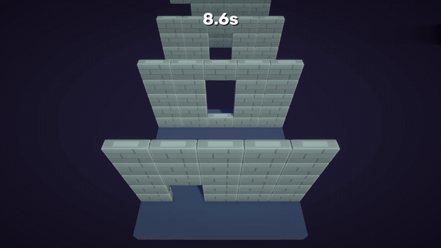
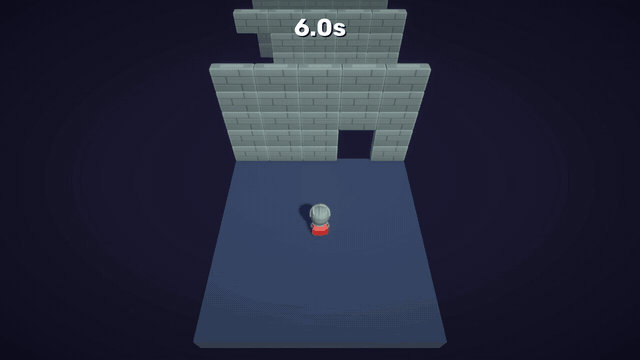
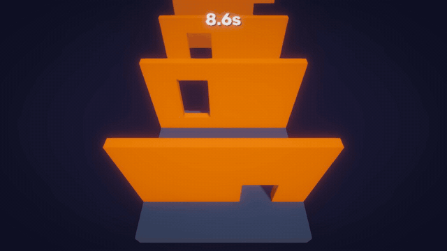
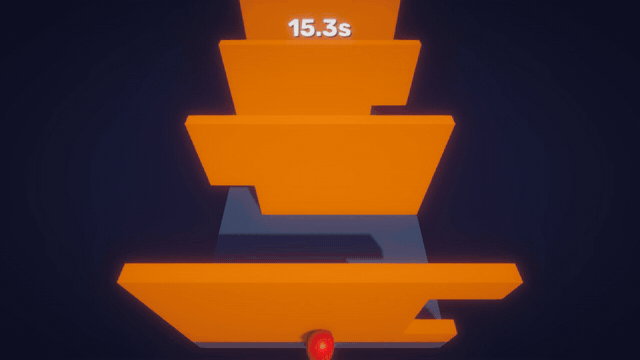

# Hole in the Wall

## About the game

A 3D dodge game made in Unity 6. Brick walls with a hole in them slide toward you on a narrow platform. Move left and right, or jump, to get through the hole.

Hitting a wall doesn't kill you. It pushes you back and you lose ground, and you only lose when you fall off the platform. Your score is how long you survive.

- **Controls:** A / D or arrow keys to move, Space to jump, R to restart
- **Engine:** Unity 6 (6000.6.0f1), URP
- **Time:** 8 days (16 to 23 September 2026), solo. Polish added on 30 September, character models on 13 October.

## Gameplay

<table>
  <tr>
    <td width="50%" valign="top"> Walking through a low hole</td>
    <td width="50%" valign="top"> Jumping into a tall hole</td>
  </tr>
  <tr>
    <td width="50%" valign="top"> A wall hits you: short freeze, red flash, pushed back</td>
    <td width="50%" valign="top"> Falling off, game over, R to restart</td>
  </tr>
</table>

## Features

- Every wall is a 5 x 5 grid of brick blocks. When a wall spawns, a script picks a random column and hides 2 blocks (a low hole you can walk through) or 3 blocks (a tall hole you have to jump into).
- A wall that hits you pushes you back instead of ending the game.
- A new wall comes every 2 seconds, and walls delete themselves once they're behind you.
- The player is an animated knight (idle, run, jump).
- Hit feedback: a short freeze, a red screen flash, sparks, camera shake, and the wall flashes white.
- The sky slowly turns red over 60 seconds. Sounds for jump, land, hit and game over.
- A time score, a saved best time, a game over screen, and R to restart.

## My contribution

- I came up with the idea and wrote the core game: the 6 gameplay scripts for moving, jumping, the walls, the holes, the score and restart.
- This was my first 3D game in Unity, so I used Claude (an AI assistant) as a tutor. It explained things, reviewed my code and set up some scene settings (UI layout, fog and colors).
- Later I asked Claude to do the polish (sparks, shake, freeze, flash, sky color, sounds, best time) and to swap in the knight and brick models. That code is in `Fx.cs` and in the polish parts of the other scripts.

## Architecture

| Script | What it does |
|:-|:-|
| `PlayerController.cs` | Moving, jumping, checking if you fell off, reacting to walls, knight animation |
| `WallSpawner.cs` | Spawns a new wall every 2 seconds with `InvokeRepeating` |
| `ObsticleMove.cs` | On every wall: moves it toward the player, flashes when it hits you, deletes it after it passes |
| `HoleMaker.cs` | On every wall: makes a random hole when the wall spawns |
| `GameManager.cs` | Time score, best time, game over, restart, sounds, the freeze and the red flash |
| `CameraShake.cs` | Camera shake and a small zoom when you jump |
| `Fx.cs` | A static helper that spawns a particle burst anywhere |

How the scripts connect:

- `GameManager` and `CameraShake` are singletons (`GameManager.instance`), and `Fx` is a static class. The player and the walls can use them without needing a reference.
- The wall prefab carries `ObsticleMove` and `HoleMaker`, so every wall moves itself, makes its own hole and deletes itself. `WallSpawner` only creates walls and never has to keep track of them.
- The player only knows about walls through the `Obsticle` tag.

What I'd change: `GameManager` now does too much (score, sounds, freeze, flash, sky), so I'd split the sounds and effects into their own scripts. The player also calls `GameManager.instance.gameOver()` directly, and an event would keep them separate. `HoleMaker` finds blocks by their names ("1" to "25"), so renaming a block would break it. An array set in the Inspector would be safer.

## How to open it

1. Open the project with Unity 6 (6000.6.0f1).
2. Open `Assets/Scenes/main game.unity` and press Play.

## Credits

- Knight and brick models: KayKit by Kay Lousberg (CC0).
- Font: Rubik (SIL Open Font License, the license file is in `Assets/Fonts`).
- Sounds are made with code, no outside files.
